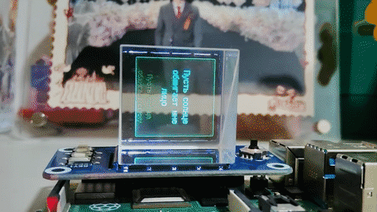
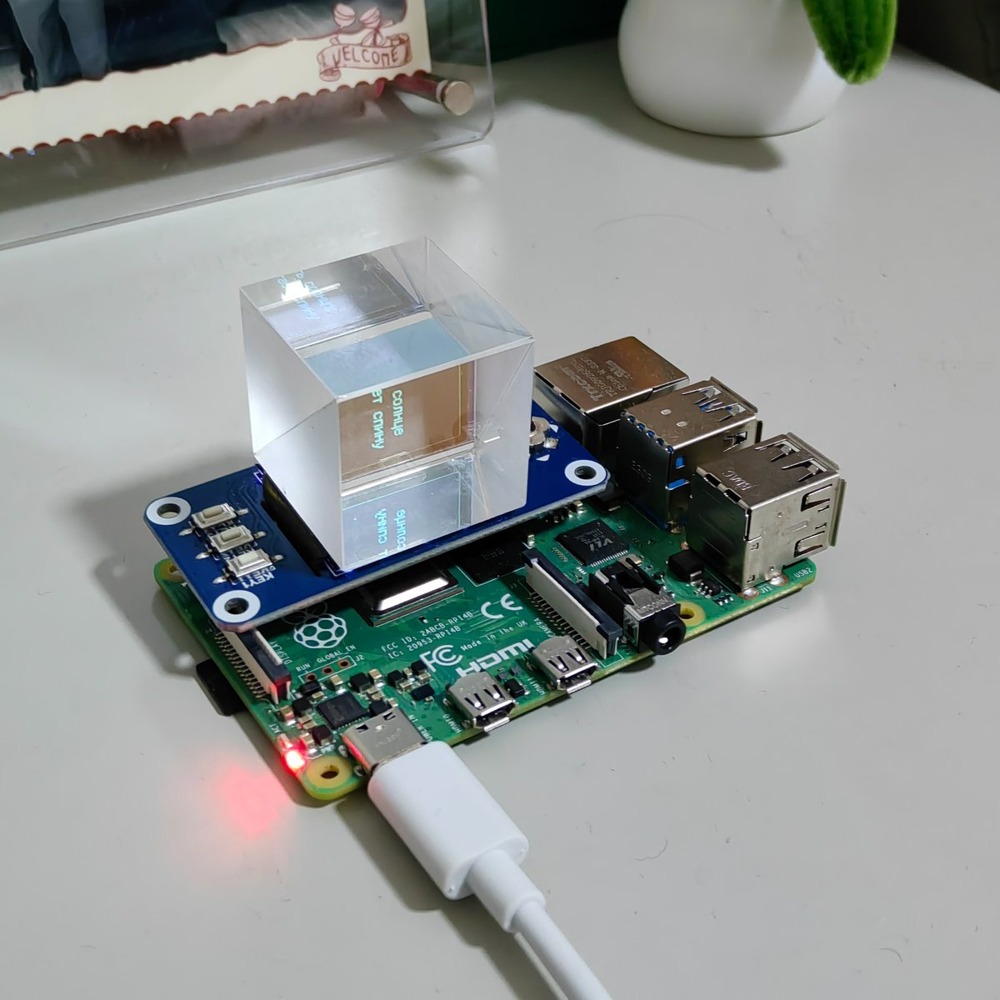
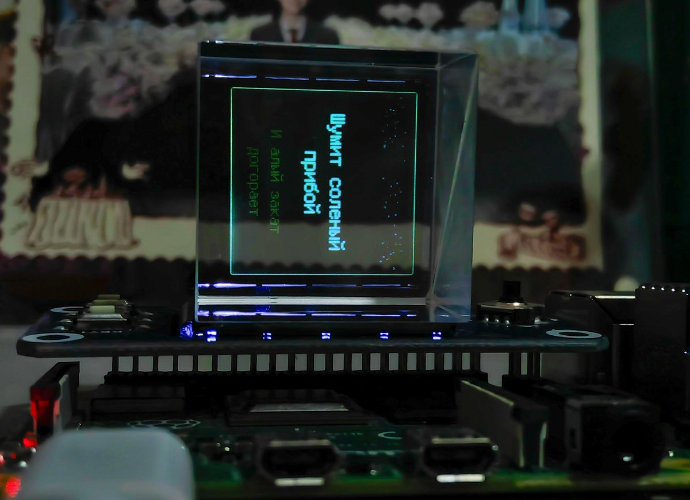

# LyricHud · 树莓派歌词屏

把手机里正在播放的歌词，实时投到一块 **240×240 的 SPI 小屏**上；叠上双三棱镜，就成了一块悬在半空的「全息」歌词屏。



| 硬件俯视 | 歌词特写 |
| --- | --- |
|  |  |

---

## 它做了什么

```
 手机                                    树莓派 4B                       小屏
┌──────────────────────────┐        ┌────────────────────────┐      ┌──────────┐
│ 酷狗音乐（MediaSession）  │        │ flask_app.py  :5588    │      │ ST7789V  │
│        ↓                 │  HTTP  │        ↓ Socket.IO     │ SPI  │ 240×240  │
│ LyricHud App（Java+Python）├───────►│ index.html（Chromium） ├─────►│ ＋三棱镜 │
│        ↑                 │  Wi-Fi │                        │      │          │
│ BLE 扫描 ←── 广播本机 IP ──┼────────┤ lyrichud-ble.service   │      └──────────┘
└──────────────────────────┘        └────────────────────────┘
```

1. 手机上的 [LyricHud App](https://github.com/1053278842/lyrics_hud_android) 从酷狗的 `MediaSession` 拿到歌名/歌手/播放进度
2. App 用 Python 拉到 LRC 歌词，整理成 JSON，`POST` 到树莓派的 `:5588/upload`
3. 树莓派把这包数据通过 Socket.IO 推给浏览器
4. 全屏 Chromium 用 CRT 像素风渲染歌词，X 画在 `/dev/fb1`，也就是 SPI 屏
5. 棱镜把画面反射到视线方向；网页用 CSS 做水平镜像，把反射造成的左右翻转抵消掉

> 树莓派的 IP 是通过 **BLE 广播**告诉手机的（company id `0x1234` + 4 字节 IP），所以**不需要固定 IP，也不需要手机开热点**——只要两端连同一个 Wi-Fi。

---

## 快速开始

两种方式，结果完全一样：

### A. 空白卡一键点亮（推荐）

刷好系统 → 把 `raspberry/` 丢进卡的 boot 分区 → 跑一次 `patch-cmdline.bat` → 开机自动装完并重启。

👉 [raspberry/provision/README.md](raspberry/provision/README.md)

### B. 手动装

```bash
git clone https://github.com/1053278842/LyricsDisplay.git
cd LyricsDisplay/raspberry
sudo ./install.sh --write-boot     # 第一次：写入屏幕配置
sudo reboot
sudo ./install.sh                  # 重启后再跑一次（也可合并成一次）
```

👉 完整步骤：[docs/SETUP.md](docs/SETUP.md)

---

## 硬件

| 部件 | 型号 |
| --- | --- |
| 主控 | Raspberry Pi 4 Model B（Bookworm 64-bit） |
| 屏幕 | ST7789V SPI TFT 240×240 |
| 光学 | 双三棱镜合成的反射镜 |
| 手机 | Android 8+（酷狗音乐 + LyricHud App） |

接线表、屏幕参数、引脚说明：[docs/HARDWARE.md](docs/HARDWARE.md)

---

## 镜像方向

棱镜是一次反射，画面会左右翻转，所以默认开了水平镜像：

```bash
sudo /home/pi/mirror.sh h     # 水平镜像（默认，棱镜最常用）
sudo /home/pi/mirror.sh v     # 垂直镜像
sudo /home/pi/mirror.sh hv    # 180°
sudo /home/pi/mirror.sh off   # 恢复正常
```

不用棱镜、直接看屏的话跑 `off`。

---

## 仓库结构

```
LyricsDisplay/
├── main.py                 # 歌词获取/格式化的入口（手机端 App 也用它）
├── lyrics/                 # 酷狗 / Spotify 歌词适配器
├── raspberry/              # ★ 树莓派端全部配置，真机原样
│   ├── install.sh          #   一键安装（幂等，支持 --dry-run / --cn-mirror）
│   ├── boot/               #   config.txt / cmdline.txt / xorg.conf.d
│   ├── systemd/            #   3 个开机自启服务
│   ├── home/               #   index.html（含镜像变量）、js、kiosk.sh、mirror.sh
│   ├── code/               #   flask_app.py、ble.py
│   └── provision/          #   空白卡首启自动安装
├── docs/
│   ├── HARDWARE.md         # 接线与屏幕参数
│   ├── SETUP.md            # 从零安装
│   └── TROUBLESHOOTING.md  # 排查手册（黑屏/BLE/镜像/网络……）
└── media/                  # README 用的图
```

---

## 三个最容易踩的坑

1. **屏幕黑了不等于坏了**——没放歌时页面本来就是纯黑；刚掉电后开机黑屏是在跑 `fsck`，等 10 分钟。
2. **不要开着桌面会话**——LightDM 和 kiosk 都画在 `/dev/fb1`，会互相覆盖。安装脚本默认禁用 lightdm。
3. **`ble.py` 必须用本仓库这版**——老版本依赖 Bookworm 已经删掉的 `hcitool`，而且 HCI 长度字段算错，广播根本发不出去。

更多：[docs/TROUBLESHOOTING.md](docs/TROUBLESHOOTING.md)

---

## 相关项目

- **手机端**：[lyrics_hud_android](https://github.com/1053278842/lyrics_hud_android) —— 从酷狗抓歌词、通过 BLE 找树莓派、HTTP 推数据
  - 直接下载：**[LyricHud-v1.0.0.apk](https://github.com/1053278842/lyrics_hud_android/releases/latest)**

## License

MIT