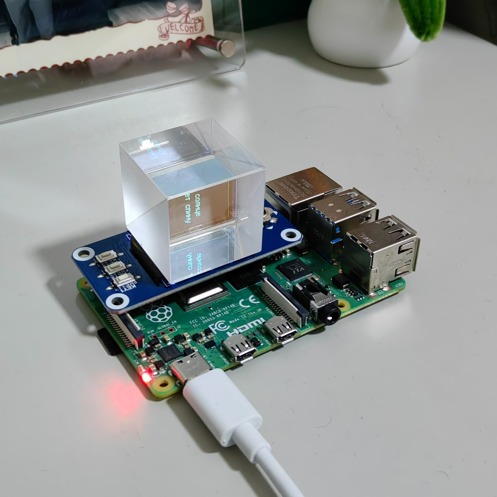

# 硬件与接线



## 清单

| 部件 | 具体型号 / 说明 |
| --- | --- |
| 主控 | **Raspberry Pi 4 Model B**（2GB 够用；3B+/5 也可，但引脚和 overlay 需自行调整） |
| 屏幕 | **ST7789V SPI TFT，240×240**（常见的 1.3 寸方屏） |
| 光学 | **双三棱镜合成的反射镜**，把屏幕画面折到视线方向（见下文「棱镜」） |
| 存储 | microSD 16GB 以上（本项目实测 16GB，系统 + 依赖约 4GB） |
| 供电 | 5V/3A 官方电源（SPI 屏从 GPIO 取电，电源弱会花屏） |
| 手机 | Android 8.0 以上（本项目在 MIUI/HyperOS 上验证） |
| 网络 | 树莓派和手机**在同一个 Wi-Fi**（或用同一路由器的有线口） |

## SPI 屏接线（BCM 编号）

屏幕丝印一般是 `GND VCC SCL SDA RES DC BLK`，对应关系：

| 屏幕引脚 | 树莓派物理引脚 | BCM | 说明 |
| --- | --- | --- | --- |
| GND | 6 / 9 / 14 | — | 地 |
| VCC | 1 或 17 | 3V3 | 逻辑供电（**不要接 5V**） |
| SCL | 23 | GPIO11 | SPI0 SCLK |
| SDA | 19 | GPIO10 | SPI0 MOSI |
| RES | 13 | GPIO27 | 复位（`reset_pin=27`） |
| DC | 22 | GPIO25 | 数据/命令（`dc_pin=25`） |
| BLK | 18 | GPIO24 | 背光（`led_pin=24`） |

屏的 **CS** 接物理引脚 **24（GPIO8 / CE0）**——overlay 里写的是 `spi0-0`，即用 CE0。

> `config.txt` 里那行 `gpio=6,19,5,26,13,21,20,16=pu` 是作者调试时留下的上拉设置，不是本项目必需；如果你换了板子出现异常，可以先删掉这行试试。

## 屏幕参数从哪来

全部在 `boot/config.txt` 的这一行里：

```
dtoverlay=fbtft,spi0-0,st7789v,reset_pin=27,dc_pin=25,led_pin=24,speed=60000000,
rotate=0,width=240,height=240,fps=60,init=-1,0x11,-2,120,-1,0x36,0x00,-1,0x3A,0x05,...
```

| 参数 | 值 | 含义 |
| --- | --- | --- |
| `speed` | 60 MHz | SPI 时钟（线太长可以降到 32 MHz） |
| `rotate` | 0 | 屏幕方向。**fbtft 只支持 0/90/180/270，没有"镜像"** |
| `width/height` | 240×240 | 面板分辨率 |
| `fps` | 60 | 刷新率上限 |
| `init` | 一长串寄存器 | ST7789V 初始化序列（含 `0x36` 扫描方向、`0x3A` 色彩格式） |

> ⚠️ 仓库里 `boot/config.txt` 那行**末尾有一段重复粘连**（`-3dtoverlay=fbtft,...`）。这是真机上能正常工作的原始值，**不要手动"清理"，也不要改 `0x36` 后面的参数**，否则屏幕颜色/方向会变。安装脚本追加的是清洗过的 `boot/config.txt.append`，两者等价。

## 为什么需要镜像

棱镜是**一次反射**，图像会左右翻转。所以网页上用 CSS 做水平镜像补偿：

```
index.html  →  :root { --mirror-x: -1; --mirror-y: 1; }
```

装好之后如果方向不对，改这两行或者直接跑：

```bash
sudo /home/pi/mirror.sh h     # 左右翻（棱镜最常见）
sudo /home/pi/mirror.sh v     # 上下翻
sudo /home/pi/mirror.sh hv    # 180°
sudo /home/pi/mirror.sh off   # 正常
```

## 结构示意

```
        ┌──────────────┐
        │  双三棱镜     │ ← 把屏幕的光折 90°，观众看到的是"正的"
        └──────┬───────┘
               │
        ┌──────┴───────┐
        │  ST7789 240² │ ← 显示镜像后的画面
        └──────┬───────┘
         SPI   │ 8 根线
        ┌──────┴───────┐
        │ Raspberry Pi │ ── Wi-Fi ── 手机 App（酷狗 → 歌词）
        │     4B       │ ── BLE  ─── 告诉手机"我的 IP 是 x.x.x.x"
        └──────────────┘
```